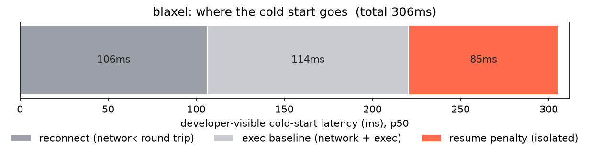

# I measured Blaxel's cold-start. Does the 25ms hold up?

A runnable benchmark for Blaxel's resume-from-standby latency. It reports the
percentiles that matter instead of a flattering average, and it pulls the network
round trip out so you can see the real resume cost. Clone it and run it in about
five minutes ([jump to setup](#run-it-yourself)).

Every "best AI sandbox" post lists Blaxel at around 25ms cold-start. E2B at 150,
Daytona at 90, Blaxel the fast one. I kept seeing that number so I went to find
where it came from. It's from Blaxel's own blog, and every comparison just
repeats it. Nobody re-ran it, and nobody shows the tail, which for cold-start is
the part that actually bites you.

Short version: the 25ms is real, but it's a server-side number. From my laptop
the cold-start is about 300ms. Break it apart and ~85ms of that is the actual
resume. The rest is network you'd pay from anywhere. Here's the work.

## How I measured it

The easy way to get this wrong is to measure your own wifi. My laptop to a
sandbox in Oregon is a round trip that can be bigger than the cold-start itself,
so a raw number tells you about my ISP as much as about Blaxel. To get around
that I time three things every trial:

- **warm**: an exec on a sandbox that's already awake. One round trip plus a tiny
  exec, no cold-start in it. That's my network baseline.
- **reconnect**: the `get()` call that reattaches to a sandbox that fell asleep.
- **cold_exec**: the first exec right after that reconnect.

Reconnect plus cold_exec is the full cold-start a developer waits on. Cold_exec
minus warm is the resume cost with the network stripped out. That last one is the
number nobody publishes.

30 trials, region `us-pdx-1`, from a laptop, trivial `echo` workload, blaxel SDK
0.4.1.

## The numbers

| metric | p50 | p95 | p99 | min | max |
|--------|-----|-----|-----|-----|-----|
| cold (total) | 307 | 339 | 349 | 275 | 350 |
| reconnect | 106 | 129 | 133 | 89 | 133 |
| cold_exec | 199 | 216 | 239 | 156 | 247 |
| warm (baseline) | 114 | 127 | 147 | 103 | 155 |

All values in milliseconds.



Reading the bar left to right, the ~306ms breaks down like this:

- **106ms is the reconnect.** `get()` is basically one network hop. No resume
  hiding in it, it's just the SDK making a call.
- **114ms is the network baseline**, the same round trip the warm exec pays.
  That's my distance to Oregon, not Blaxel.
- **85ms is the real resume.** The first exec after reconnect costs about 85ms
  more than a warm one. That's the asleep-to-awake cost with the network removed.

## So does 25ms hold up?

Yes and no, and the gap is the interesting part.

The 25ms is believable as a server-side number, the microVM waking up inside
their own network. My 85ms is that same event seen from outside, and it still
includes whatever the first exec spends setting up, so the real engine number
could be even lower. On that, Blaxel checks out.

But no developer ever sees 25ms, because you're talking to the box over a
network. From my laptop it's about 300ms, and that's two round trips plus the
resume. In-region, where the round trip is a few ms instead of 110, I'd expect
somewhere near 100ms, not 25, because you still pay a full reconnect and the
resume still lands on the first exec.

The tail is where Blaxel looks good. p99 is 349ms, only about 14% over the
median. Nothing weird, no request that randomly takes two seconds. Whatever they
do for resume is steady, and you can't see that in a single number.

## What I'd actually tell a developer

If your agent wakes a sandbox and runs code, plan for ~300ms from a remote
client and ~100ms if you're colocated. Not 25. The 25ms is the engine, not the
trip. That's not a knock, it's just the difference between a spec sheet and what
your users feel, and honestly it's the kind of thing the docs could just say.

## Run it yourself

Needs Python 3.11+ (the SDKs don't ship 3.8 wheels).

```bash
git clone https://github.com/ldhir/sandbox-coldstart-bench
cd sandbox-coldstart-bench
python3.11 -m venv .venv && source .venv/bin/activate
pip install -r requirements.txt
# on x86_64 macOS without Rust, if cbor2 fails to build:
#   pip install --only-binary=:all: cbor2   # then rerun the line above

cp .env.example .env      # add your Blaxel key (free tier: $200, no card)
python run.py             # 30 Blaxel trials, prints the table + writes charts
```

Longer run, or add a create-fresh platform as a reference point:

```bash
python run.py --n 100                    # tighter tails
python run.py --platforms blaxel,modal   # also benchmark Modal (needs a Modal token)
python run.py --no-plot                  # skip charts (no matplotlib needed)
```

If your numbers don't match mine, open an issue. That's the point of shipping
code instead of a screenshot.

### Output

- `results/results.json` — full summary plus raw samples
- `results/decomposition.png` — where the cold start goes (network vs resume)
- `results/cdf.png` — cold-start latency CDF
- `results/percentiles.png` — p50/p95/p99 bars

### Layout

```
run.py                   CLI entry point
bench/blaxel_bench.py     Blaxel resume-from-standby harness (async)
bench/modal_bench.py      Modal create-fresh harness (reference point)
bench/stats.py            percentiles, no numpy needed
bench/plot.py             CDF, percentile, and decomposition charts
```

## Caveats

- Measured from a laptop, so the raw number includes my round trip to
  `us-pdx-1`. The breakdown subtracts it, which is why the 85ms resume is the
  number to trust, not the 300ms.
- That 85ms also includes whatever the first exec spends connecting to the
  sandbox, so treat it as a ceiling on the real resume, not the exact figure.
- This is Blaxel only. The harness also does a create-fresh platform as a
  reference point with one flag (`--platforms blaxel,modal`), I just kept this
  run focused on Blaxel's own number.
- 30 trials, one region, one workload. Enough to see the shape, not a load test.
  Bump `--n` for tighter tails.
