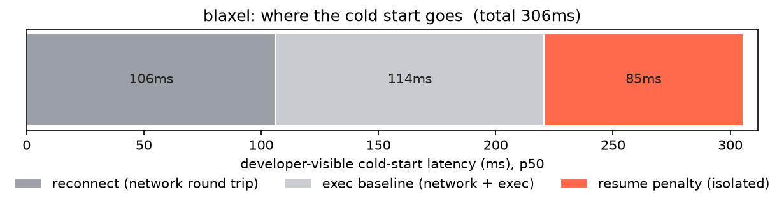

# Does Blaxel's 25ms hold up? I measured it.

If you've read any "best AI sandbox" post in the last year, you've seen Blaxel
listed at ~25ms cold-start. E2B around 150ms, Daytona around 90ms, Blaxel the
fast one at 25. I kept seeing that 25ms number and got curious where it came
from, so I went looking.

It comes from Blaxel's own blog. Every comparison post I found repeats it, and
every one of them traces back to the same source. Nobody re-measured it. And
none of them report what happens at the tail, which for cold-start is the part
that actually matters. A median of 25ms is a nice headline, but the request your
user feels is the slow one, and nobody publishes the p99.

So I built a small thing that clones and runs, measures the full distribution,
and does one thing the marketing number can't: it separates the actual resume
cost from the network round trip, so you can see what's really going on.

The short version: the 25ms is real, but it's a server-side number. From a
developer's laptop you see about 300ms, and once you break that down, ~85ms of
it is the actual standby-resume and the rest is network you'd pay from any
remote client. Here's the work.

## What I measured

The trap with these benchmarks is measuring your own wifi. My laptop to a
sandbox in Oregon has a network round trip that can be bigger than the
cold-start itself, so a raw number tells you as much about my ISP as it does
about the platform. To get around that I measure three things per trial and
subtract:

- **warm**: an exec on an already-live sandbox. This is one network round trip
  plus a trivial exec, no cold-start in it. It's my network baseline.
- **reconnect**: the `SandboxInstance.get()` call on its own, which is how you
  reattach to a sandbox that fell to standby.
- **cold_exec**: the first exec right after reconnecting.

Add reconnect and cold_exec and you get the full developer-visible cold start.
Subtract the warm baseline from cold_exec and you get the resume penalty with
the network taken out. That last number is the one nobody else publishes.

Run config: 30 trials, Blaxel region `us-pdx-1`, from a laptop (not in-region),
trivial `echo` workload, August 2026, blaxel SDK 0.4.1.

## The numbers

| metric | p50 | p95 | p99 | min | max |
|--------|-----|-----|-----|-----|-----|
| cold (total) | 307 | 339 | 349 | 275 | 350 |
| reconnect | 106 | 129 | 133 | 89 | 133 |
| cold_exec | 199 | 216 | 239 | 156 | 247 |
| warm (baseline) | 114 | 127 | 147 | 103 | 155 |

All values in milliseconds.

Read the bar left to right. Of the ~306ms a developer waits after standby:

- **106ms is the reconnect round trip.** `get()` is basically one network hop.
  There's no hidden resume cost buried in it, it's just the SDK making a call.
- **114ms is the network baseline.** This is the same round trip the warm path
  pays. It's my laptop-to-Oregon distance, not Blaxel.
- **85ms is the actual resume penalty.** The first exec after reconnect costs
  ~85ms more than a warm exec. That's the standby-to-active cost you can't get
  rid of, isolated from the network.

## So does 25ms hold up?

Yes and no, and the gap is the interesting part.

The 25ms is plausible as a **server-side** number, the microVM resuming inside
their infrastructure. My ~85ms isolated resume penalty is the same event seen
from the outside, and it includes whatever connection setup the first exec pays,
so the true microVM resume is likely smaller than 85ms and 25ms is believable.

But no developer ever experiences 25ms, because you talk to the sandbox over the
network. From my laptop the honest, developer-visible cold start is ~300ms, and
it splits into two network round trips plus ~85ms of resume. If I ran this
in-region, where the round trip is ~5ms instead of ~110ms, I'd expect roughly
100ms wall-clock, not 25ms, because you still pay a full reconnect call and the
resume lands on the first exec.

The tail is the good news for Blaxel. p99 is 349ms, only about 14% above the
median. No ugly outliers, no request that suddenly takes two seconds. Whatever
they're doing for resume is consistent, and consistency is the thing you can't
see in a single marketing number.

## What I'd tell a developer

If your agent reconnects to a warm-ish sandbox and runs code, budget ~300ms from
a remote client and ~100ms if you're colocated, not 25ms. The 25ms is the engine,
not the trip. That's not a knock, it's just the difference between a spec sheet
number and what your users feel, and it's the kind of thing the docs could say
out loud.

## Run it yourself

The repo is [link]. Clone it, add a Blaxel API key (free tier, no card), run
`python run.py --platforms blaxel`. It prints the table above and writes the
charts, including the decomposition. If your numbers don't match mine, open an
issue. That's the whole point of shipping the code instead of a screenshot.

## Caveats I'd want a reader to know

- Measured from a laptop, so the raw numbers include my round trip to `us-pdx-1`.
  The decomposition subtracts it, which is why the ~85ms resume penalty is the
  number to trust, not the ~300ms total.
- The ~85ms resume penalty includes whatever the first exec pays to set up its
  connection to the sandbox, so it's an upper bound on the true microVM resume,
  not a pure measurement of it.
- This run is Blaxel only. Adding Modal as a create-fresh reference point is a
  one-flag change (`--platforms blaxel,modal`), and the harness already supports
  it. I left it out here because I didn't want to spin up a second billed
  account just to make a point about Blaxel's own number.
- 30 trials, single region, one workload. Enough to see the shape, not a load
  test. Bump `--n` for tighter tails.
